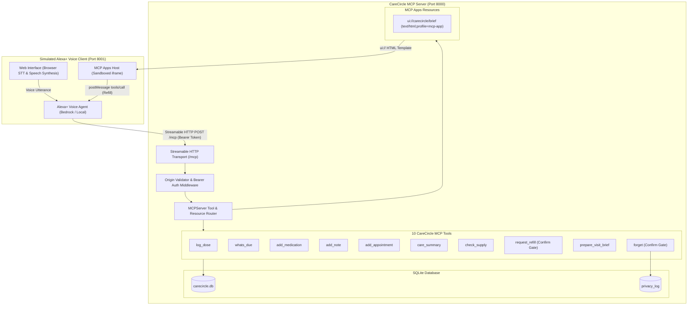

# CareCircle • Alexa+ Family Care Coordinator

[](https://modelcontextprotocol.io/specification/2025-11-25)
[](https://github.com/modelcontextprotocol/ext-apps)
[](LICENSE)
[](https://www.python.org/)

> **Track**: Alexa+  
> **Hackathon**: *"Build, Ship, Shape: Amazon Developer Hackathon"* (Devpost)  
> **Technology**: Self-hosted MCP Server implementing MCP specification **2025-11-25** over **Streamable HTTP** at `/mcp`, with **MCP Apps (2026-01-26)** interactive cards and a simulated Alexa+ voice client.

> [!WARNING]
> **Demo Only — Not Medical Advice**: CareCircle is an engineering proof-of-concept for family care coordination. It is for demo and hackathon evaluation purposes only and does NOT constitute medical advice, medical diagnosis, or clinical prescription guidance. All pharmacy orders placed through `request_refill` are simulated mocks.

---

## What is CareCircle?

**CareCircle** is an Alexa+ add-on (MCP Server) that turns Alexa into a shared, private care coordinator for a family caring for an aging parent.

Instead of fragmented WhatsApp messages, forgotten pill boxes, and stressful doctor visits:
1. **Single Private Source of Truth**: Keeps a shared, private record of medicines, doses taken, remaining stock, symptom notes, and appointments in SQLite.
2. **Cross-Session & Cross-Family Identity**: Identifies each family member from their authenticated bearer token—never from tool arguments.
3. **Safety & Confirmation Gates**: Any action that spends money (refill orders) or deletes data permanently (`forget`) enforces explicit confirmation before taking action.
4. **Interactive MCP Apps Visual Card**: Generates a doctor visit brief card (`ui://carecircle/brief`) showing 14-day adherence, logged symptoms, and smart doctor questions, complete with an interactive "Request Refill" button.
5. **Mock Pharmacy Refill**: Integrates with simulated pharmacy fulfillment (labeled clearly as a mock).

---

## Architecture Diagram



---

## 5-Step Demo Story

The system supports the following real-world scenario end to end:

| Step | Speaker | Role | Spoken Voice Utterance | Alexa+ Spoken Reply & Action |
|:---|:---|:---|:---|:---|
| **1** | **Amma** | Patient (Morning) | *"I took my BP tablet."* | *"I've logged your Amlodipine (BP tablet) dose at 8:10 AM."* — Dose logged, pill count decremented. |
| **2** | **Ravi** | Caregiver (Evening) | *"Did Amma take her medicines today?"* | *"She took the BP tablet at 8:10 AM and Vitamin D3 at 9:00 AM. The 2:00 PM Metformin (sugar tablet) is not logged yet."* |
| **3** | **Priya** | Caregiver | *"Prepare me for Amma's cardiology visit on Monday."* | Synthesizes 14 days of doses, missed doses, and symptoms into a spoken summary and renders the **MCP Apps Doctor Brief Card** in the iframe. |
| **4** | **Ravi** | Caregiver | *"Her BP tablets are running low."* | *"Amlodipine (BP tablet) has 2 days of supply left (5 pills). Should I place a mock pharmacy refill order for 60 pills?"* — **Requires explicit confirmation** before placing order `#MOCK-1`. |
| **5** | **Ravi** | Caregiver | *"Forget the note about her dizziness."* | Prompts for confirmation; upon confirmation, permanently erases note from database and writes an immutable entry to `privacy_log`. |

---

## Demo Family & Bearer Tokens

The seed script creates a realistic multi-generational family:

| Name | Role | Access Permissions | Demo Bearer Token |
|:---|:---|:---|:---|
| **Amma** | `patient` | Read/Write (log doses, view schedule) | `54fe2f2b04205ed2991c4c5c029f43fc682754c4f6578b9d82fb4b8593915de9` |
| **Ravi** | `caregiver` | Read/Write (full care coordination & refills) | `56b7555775f4ddaa354227ee25696e21c7fcd7094ed262255da83eb2f216482a` |
| **Priya** | `caregiver` | Read/Write (doctor briefs, appointment notes) | `47afb499828b92e038a6d1aa077d1b1a750e99e1eb333ae0e7b1b38e5883ec7d` |
| **Dr. Rao's Clinic** | `viewer` | Read-Only (care summaries & doctor briefs) | `83c040fc3e6d6afcbc0fbb7623b7f620451e7d371d3b8be36a1518ad3d994e2d` |

*(Note: Run `python scripts/seed.py` at any time to regenerate tokens stored in `scripts/.tokens.json`)*.

---

## Quickstart & Installation

### Prerequisites
- Python 3.13
- Git

### 1. Setup Virtual Environment & Dependencies
```bash
# Clone the repository
git clone https://github.com/NanduKondreddy/CareCircle.git
cd carecircle

# Create and activate virtual environment
python -m venv .venv
# Windows:
.venv\Scripts\activate
# Linux/macOS:
source .venv/bin/activate

# Install dependencies
pip install -r requirements.txt
```

### 2. Populate Demo Data
```bash
python scripts/seed.py
```
This populates 14 days of realistic dose logs, 3 medications (BP tablet, sugar tablet, vitamin D), symptom notes (including morning dizziness), and an upcoming cardiology appointment.

### 3. Start the CareCircle MCP Server
```bash
python server/main.py
```
*Server starts on `http://127.0.0.1:8000/mcp`.*

### 4. Start the Simulated Alexa+ Voice Client
In a second terminal:
```bash
python client/app.py
```
*Voice client interface opens at `http://127.0.0.1:8001`.*

---

## Testing & Verification

### Automated Verification Suites
CareCircle includes 6 automated verification suites testing every layer of the MCP specification:

```bash
# Check 2: MCP Spec 2025-11-25 Protocol Version Handshake
python verify_init.py

# Live MCP Elicitation over Streamable HTTP (Modal Confirmation Flow)
python tests/test_real_elicitation.py

# Check 5: Unscripted Free Speech Test ("Has Amma missed any medicines this week?")
python tests/test_free_speech.py

# Phase 2: Origin check (403), bearer auth (401), role gates, and tools 1-6
python tests/test_phase2.py

# Phase 3: check_supply, request_refill, prepare_visit_brief, forget, privacy log
python tests/test_phase3.py

# Phase 4: MCP Apps card, ui:// resource discovery, MIME types, _meta linkage
python tests/test_phase4.py

# Phase 5: Complete 5-step demo story end-to-end
python tests/test_demo_story.py
```

### Testing with MCP Inspector
You can inspect and call all 10 tools directly using the official MCP Inspector:
```bash
npx @modelcontextprotocol/inspector
```
1. Set Transport to **Streamable HTTP**.
2. URL: `http://127.0.0.1:8000/mcp`.
3. Add Custom Headers:
   - `Authorization`: `Bearer <Ravi's token from scripts/.tokens.json>`
   - `Origin`: `http://localhost:8000`
4. Click **Connect**.
5. Test Elicitation: Call `request_refill` for `BP tablet`. You will see an elicitation confirmation modal appear in the Inspector!

### Testing in MCP Apps Hosts (MCPJam / Claude Desktop)
To test in an MCP Apps host such as [MCPJam](https://www.mcpjam.com) or Claude Desktop:
1. Ensure `server/main.py` is running on port 8000.
2. In host server settings, configure:
   ```json
   {
     "mcpServers": {
       "carecircle": {
         "url": "http://127.0.0.1:8000/mcp",
         "headers": {
           "Authorization": "Bearer <Ravi's token from scripts/.tokens.json>",
           "Origin": "http://localhost:8000"
         }
       }
     }
   }
   ```
3. Call `prepare_visit_brief` or `care_summary`. The host detects `_meta.ui.resourceUri = "ui://carecircle/brief"`, fetches the card via `resources/read`, and renders the visual interface inline with the interactive "Request Refill" button!

> [!NOTE]
> Our web client does not implement the separate-origin sandbox proxy that the spec requires for web hosts. Use MCPJam or Claude Desktop for a fully compliant host.

---

## Repository Structure

```
carecircle/
  server/
    main.py           # MCPServer entry point with Streamable HTTP & security middleware
    db.py             # Plain SQLite3 database connection and fuzzy medication search
    security.py       # SHA-256 token hashing, bearer auth, and origin validation
    ui/
      brief.html      # Self-contained MCP Apps card (ui://carecircle/brief)
    tools/
      phase2.py       # Tools 1-6 (log_dose, whats_due, add_medication, etc.)
      phase3.py       # Tools 7-10 (check_supply, refill, brief, forget)
  client/
    app.py            # Simulated Alexa+ voice client backend with agent router
    static/
      index.html      # Voice interface (STT, TTS, speaker switcher, iframe card)
  scripts/
    seed.py           # Database seeder creating demo family, meds, and logs
  tests/
    test_phase2.py    # Tests for auth, origin, and first 6 tools
    test_phase3.py    # Tests for confirmation gates, refills, briefs, and privacy log
    test_phase4.py    # Tests for MCP Apps UI card and resource discovery
    test_demo_story.py# End-to-end verification of the 5-step demo story
  SKILL.md            # Agent instructions for voice conversational style & safety
  FRICTION_LOG.md     # Engineering hurdles and workarounds encountered
  LICENSE             # MIT License
  requirements.txt    # Project dependencies
  .env.example        # Environment variable template
```

---

## Safety & Disclaimers

> [!IMPORTANT]
> **Mock Pharmacy Orders**: All pharmacy refills placed by `request_refill` are simulated **mock orders** (`status='placed (mock)'`). No real financial transactions, pharmacy APIs, or medication deliveries are conducted.

> [!NOTE]
> **Privacy Auditability**: Any deletion requested through `forget` is permanently recorded in `privacy_log` with actor ID, timestamp, and target entity for family transparency.

> [!NOTE]
> **MCP Apps Web Host Compliance**: Our web client does not implement the separate-origin sandbox proxy that the spec requires for web hosts. Use MCPJam or Claude Desktop for a fully compliant host.

---

## Screenshots Placeholder

| Simulated Alexa+ Voice Client | MCP Apps Doctor Brief Card |
|:---:|:---:|
|  |  |
*(Screenshots captured from live client running at http://127.0.0.1:8001)*.
